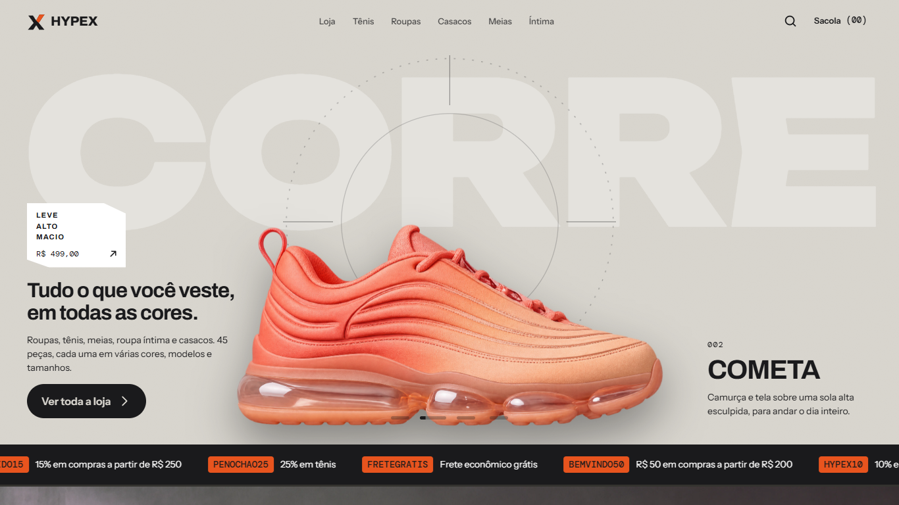

# Hypex

Loja fictícia de moda criada para portfólio. Roupas, tênis, casacos, meias e roupa íntima, com 45 produtos, cada um em várias cores, modelos e tamanhos. A interface tem vitrine interativa, troca de cor com animação, filtros, busca, sacola, cupons, frete por CEP e checkout simulado.



## Executar localmente

```powershell
python -m http.server 8000
```

Abra [http://localhost:8000](http://localhost:8000). HTML, CSS e JavaScript puros, sem framework, sem build e sem dependências. Pode ser publicado direto no GitHub Pages.

## O que o projeto demonstra

- **Arquitetura em camadas sem framework:** dados, regras de negócio puras e interface separados em arquivos diferentes (veja abaixo).
- **Regras comerciais testáveis:** frete, cupons, desconto no Pix e total ficam em funções puras, sem acesso ao DOM, e têm testes automatizados.
- **Layout fluido e fiel:** a página mantém as mesmas proporções em qualquer monitor ou TV desktop (explicado em [Escala da interface](#escala-da-interface)).
- **Animação e movimento:** rolagem guiada, transições entre cores, canvas de neve e fumaça, vitrines de tênis com troca de iluminação. Respeita `prefers-reduced-motion`.
- **Acessibilidade:** `aria-*`, gaveta de compra como diálogo modal (o restante da página fica `inert` enquanto ela está aberta) e atalhos de teclado nas páginas de produto.
- **Segurança no cliente:** dados do `localStorage` são validados antes de virar HTML e nenhum dado pessoal é persistido.

## Organização

```
index.html              documento e ordem de carregamento dos scripts
css/
  estilo.css            identidade visual, layout base e páginas
  movimento.css         cenas animadas e rolagem
  efeitos.css           transições, cursor, loja e filtros
  tenis.css             vitrine e câmera dos tênis
  vitrine-cor.css       vitrine de cor das roupas e gaveta de compra
  arara-scroll.css      arara de roupas presa à rolagem
js/
  dados/catalogo.js     "banco de dados": produtos, cores, tamanhos, cupons, departamentos
  dominio/comercio.js   "back-end" do navegador: frete, descontos, totais (funções puras)
  interface/            renderização, rotas, animações e interações
img/                    fotos do catálogo, modelos e variações usadas pelo site
tests/                  testes das regras comerciais e da integridade do catálogo
docs/                   arquitetura e revisão de segurança
```

Não existe servidor: tudo que seria "back-end" numa loja real (catálogo, preços, cupons, frete) está em `js/dados` e `js/dominio`, isolado da interface, de modo que poderia ser trocado por uma API sem mexer em `js/interface`. Detalhes em [docs/architecture.md](docs/architecture.md).

## Escala da interface

Todas as medidas do CSS usam `rem`. O desenho de referência tem **1360 px de largura** (1 rem = 16 px). A partir de 1181 px de largura, `html { font-size: calc(100vw / 85) }` faz o `rem` acompanhar a janela, então a página fica com a mesma composição em 1360×720, 1920×1080, 2560×1440 ou numa TV, apenas maior ou menor. Abaixo de 1181 px valem os layouts de tablet e celular, que usam `px` reais.

Ao criar estilos novos, use `rem` (por exemplo, `1.5rem` no lugar de `24px`). Consultas `@media` continuam em `px`, porque medem a janela.

## Comportamento ao recarregar

Ao recarregar o site (F5), a visualização volta ao topo da página. O navegador não restaura a posição de rolagem (`history.scrollRestoration = 'manual'`). Clicar na logo também reinicia a tela de abertura. Ao navegar entre seções na mesma visita, a interface guarda a posição de rolagem de cada rota.

## Verificação

```powershell
node --test tests/comercio.test.cjs tests/catalogo.test.cjs
```

- `comercio.test.cjs`: frete, cupons, desconto no Pix e totais.
- `catalogo.test.cjs`: ids únicos, cores e departamentos válidos e existência de cada foto usada pelo catálogo, para evitar imagens quebradas.

Verificação manual feita com Playwright em 1360×720, 1440×900, 1536×864 e 1920×1080: todas as rotas, os 45 produtos, a troca de cor, a compra e o checkout carregam sem erros de console, sem requisições com falha e sem rolagem horizontal.

## Demonstração e privacidade

Não há backend, API ou banco de dados. Nenhum pagamento é processado nem pedido enviado. Use o botão de dados de exemplo no checkout; não informe dados reais de cartão. A sacola e o cupom ficam no `localStorage`. O pedido simulado existe apenas enquanto a página está aberta; nome, e-mail e endereço não são gravados no armazenamento local.

As fotos são referências geradas para a demonstração. Um uso comercial exigiria fotos verificadas, validação de preços e estoque no servidor e um provedor de pagamento.

## Publicação

Publique a raiz do repositório como site estático. A navegação usa rotas com `#`, que funcionam no GitHub Pages sem configuração de redirecionamento. O `.gitignore` exclui arquivos locais de ambiente, credenciais, capturas e configurações do editor.
